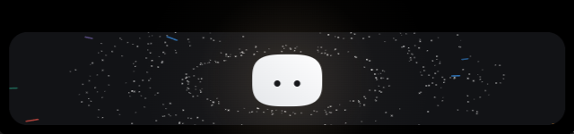
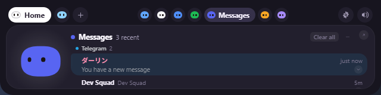
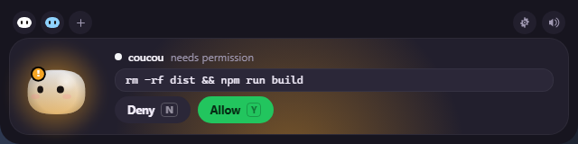
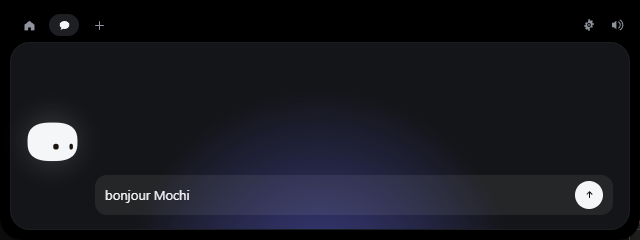
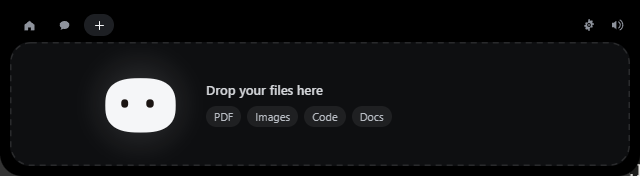
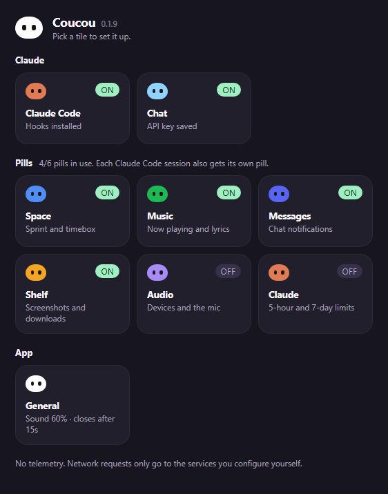

<div align="center">


# Coucou for Windows

**Mochi doesn't get a notch on a PC — so it lives at the top of your screen instead.**

Approve Claude Code permissions, watch your session work, drop a file, chat with Claude, keep an eye on your services — without leaving what you're doing.


</div>



---

## Install

The downloadable installer is **temporarily unavailable**. Microsoft Defender
wrongly flags the unsigned installer as malware (`Trojan:Win32/Wacatac.H!ml`, a
machine-learning false positive). A report is under review at Microsoft, and the
installer will be published again once it is cleared and code-signed.

Until then, [build it yourself](#build-it-yourself): it takes a few minutes and
installs for the current user only — no admin prompt.

## Using it







| What you do | What happens |
|---|---|
| Move the mouse to the very top-centre of the screen | The island opens, no click needed |
| Move the mouse there while a fullscreen game, video or presentation is in front | Nothing: hovering never opens Mochi over it (click the top-centre to open on purpose). New messages wait as a badge too |
| Move the pointer off the island | It closes at once. The chat and anything that opened on its own (a finished session) wait for **Auto-close** instead; a permission request stays until answered |
| Turn off **Open on hover** (Settings → General) | Hovering only shows the compact island; a click opens it, and leaving waits for **Auto-close** |
| Click Mochi | It gets annoyed. Three times in a row and it goes dizzy |
| Right-click Mochi (or tray → Wardrobe…) | The wardrobe opens: rest the pointer on an outfit to try it on, click to keep it |
| Rest the pointer on Mochi for two seconds | Hearts |
| Drag Mochi out of the island | He lives on the desktop in a little window of his own, until you double-click him or drop him back on the island |
| Drag a file onto the island | Mochi turns into a box, swallows it, then offers to answer questions about it |
| `Esc` | Closes the island |
| `Ctrl+Alt+Space` from any app | Opens the chat; the other global shortcuts are below |
| Tray icon | Open, Weekly recap, Wardrobe…, Settings…, Pause, Quit |

Everything else happens on its own: a Claude Code permission request opens the
island with **Deny / Allow**, a finished session shows what it did, and
your integrations sit in the coloured pills next to Mochi.

**Open terminal** (a session's card, or its ↗) brings forward the window that
session runs in: Windows Terminal, VS Code, Cursor… When the relay connects,
Rust walks up its process tree (`session_window.rs`, once per session, kept in
memory by session ID) to the nearest ancestor that owns a window, and picks the
one titled after the project when an editor has several. A classic console
(`cmd.exe`, whose window belongs to conhost) has no such ancestor, so there the
folder opens in VS Code as before. From upstream `c90d30b`.

A permission, plan or question card takes the focus for the session that asks.
Once it is answered (here or in the terminal) or times out, the pill you were on
before, Music for instance, gets the focus back, the same way it does after a
new message's three-second glance. A pill you picked yourself meanwhile stays.

The island stays above other windows, including other always-on-top ones: every
time another app comes to the front, Coucou puts itself back on top (an event
hook, so nothing runs while nothing changes), and while the island is showing it
also checks twice a second for overlays that pop up without taking the front. A
fullscreen game, video or presentation is left alone.

**Auto-close** follows Settings at once: a delay changed while the countdown
bar runs starts that countdown again with the new delay (the state machine owns
the deadline, `fsm.ts homeCollapseDueAt`; a new message's 3 s glance keeps its
own). From upstream `62e43c6`.

**Your own sounds** (Settings → General → Open sounds folder): put a file named
like one of Mochi's sounds (`finish.wav`, `approval.mp3`, `greet.m4a`…) in
`%APPDATA%\Coucou\sounds` and click **Reload sounds**; Mochi plays a pop with
the new set. Formats tried in order: wav, mp3, ogg, oga, m4a, aac, flac, aiff,
aif, caf; up to 8 MB; names are bare lowercase words, so nothing outside the
folder can be read (`sounds.rs`). A file the webview can't decode falls back to
the built-in sound. From upstream `2261334`.

**Island lives on** (Settings → General): the main display, the display under
the cursor, or one display by name (`DELL U2720Q · 2560×1440 at -2560,0`). A
display is saved by its logical origin (`at:<x>,<y>`), not its name, since two
monitors of the same model share one. When it is unplugged or moved, the island
goes to the main display and Settings shows that. From upstream `4207be9`.

**Launch at startup** (Settings → General) is checked at every launch, not only
when you flip it. The login entry (`HKCU\Software\Microsoft\Windows\CurrentVersion\Run\Coucou`)
holds a path, and an install that moved, from `C:\Program Files` to the per-user
`%LOCALAPPDATA%\Coucou`, used to leave it pointing at an exe that no longer exists,
so Coucou silently stopped starting at login. Now a missing or stale entry is
rewritten to the running exe (the log says `autostart on: <path>`). An entry that
already names this exe is left alone, so turning Coucou off in Task Manager's
Startup apps still sticks. A debug build (`npm run tauri dev`) never touches it.

## Claude Code



Open **Settings… → Claude Code → Install hooks…**. You get the exact diff of what
will change in `%USERPROFILE%\.claude\settings.json`, the path of the dated backup
that will be taken, and nothing is written until you click. Your own hooks are
never touched, and uninstalling removes only Coucou's entries.

The relay is a tiny executable, `coucou-hook.exe`, copied to
`%LOCALAPPDATA%\Coucou\bin\` at launch. It is given 300 ms to reach Coucou and
exits cleanly if the app is closed, slow or crashed — **a Claude Code session is
never blocked or slowed down by Coucou.** If nobody answers a permission request
in time, Coucou stays quiet and Claude Code asks in the terminal as usual.

It works from any terminal — Windows Terminal, PowerShell, VS Code, Git Bash.

### Wardrobe

Mochi can wear one of eleven outfits, all drawn in code like him: party hat,
beanie, crown, sunglasses, round glasses, bow, scarf, witch hat, pumpkin, Santa
hat, bunny ears, or **Auto**, which follows the seasons (party hat at New Year,
Santa hat in December, witch hat in October, bunny ears around Easter,
sunglasses in summer). This build starts on **None**, so Mochi looks as he
always has until you pick one; the choice is `mochiOutfit` in settings.json.
The old outfit leaves, the new one drops in with a little squash, and the soft
parts (pompoms, hat tips, the scarf's end) lag behind his moves on a spring.

The main Mochi wears it, also on the compact island; on the open island a
focused integration pill shows its own colours instead (the wardrobe excepted).
When an act puts something on his head (the Music headphones, the Audio
headset, the Space hard hat, the Shelf box, a thought cloud, a terminal, smoke),
a hat lifts away while it plays and drops back after; glasses, a scarf or a bow
stay on (`acts.ts actCoversHead`). From upstream `23c09b9`, `396cf29`,
`c97dec1`; the outfits are split into `src/mochi/outfits/` here.

### The launch greeting

At launch Mochi falls into the island through warp streaks, bounces, slides
to the side and waves with a quick little hand, then comes back and settles in
the compact island, with the Mac's `greeting.wav`; the sound fades out when the
greeting is left early. The island's 340 ms close curve is used for the
collapse, so his body is never cut off (`tests/greeting.test.ts` runs the
geometry frame by frame). From upstream `d02f820`.

Mochi's drawing has deterministic snapshot pages for refactors:
`dev/engine-snapshot.html` (every state, act, emote and badge; `?outfits` for
the outfits), `dev/outfits-snapshot.html` and `dev/greeting-snapshot.html`
freeze the clock and seed `Math.random`, so two runs draw the same pixels.

### Mochi on the desktop

Drag Mochi out of the island and drop him anywhere: he stays there, in a
120 px window of his own, and comes back to that spot at the next launch. He
shows the same mood and outfit as the island, and here also the focused pill's
act and colour (a one-shot travels as its age, since each window has its own
clock: `desktopLogic.ts packActs / liveAct`). His eyes follow the cursor; after
two quiet minutes with the pointer away he dozes off, and asleep the cursor
poll stops entirely.

| What you do | What happens |
|---|---|
| Click him | A poke; three in a row, dizzy, and the island shows the confused view |
| Double-click him, or drop him on the island | Home for good |
| Right-click him | The wardrobe opens on the island |
| Drag him | A new spot |

A permission, a plan or a question waiting for an answer flies him back to the
island (surprised first); once it is answered he flies out to his spot again.
An integration's alert (a message, a usage limit, a deploy) needs no answer,
so he only looks up from where he is. A click on the island's Mochi now slaps
him when the button comes up, so dragging him out never slaps him first
(`island/botDrag.ts`). From upstream `dde859e`, `64bb85e`, `b52bbe3`,
`7a8d5e6`; the acts, the pill colour and the question card are this build's.

### Weekly recap

On Monday from 8 am, the first time Coucou starts, an agent starts work or the
island wakes up, and nothing else is on screen (no card waiting, no chat), the
island opens on **last week**: time coding, sessions, files, +lines / −lines,
commands, then the top agent, top project, busiest day, longest session,
permissions allowed and denied, and questions answered. Once a week; the tray's
**Weekly recap** opens it any day. **Share image** draws a 1080×1920 picture of
the week (project names can be left out), which **Save image** puts in
Pictures (or Downloads) and **Copy** puts on the clipboard.

Only counts and two names are kept per turn (the agent's pill and the project
folder's last component), never a command, a path, file contents or a prompt,
in `%LOCALAPPDATA%\Coucou\recap.json`, for 12 weeks (`src-tauri/src/recap/`,
read and written through `prefs_file.rs`, so a corrupt file is set aside, not
lost). The weeks, the busiest day and the rest are worked out on the island in
the user's own time zone (`recap/summary.ts`). Settings → General → Weekly
recap turns the history off or clears it. From upstream `8d47969`, `43c13ed`,
`9806b66`; restyled as Mochi Pop and a little taller here.

### Live diff

Each file Claude Code edits shows on its session's tile on Home: the line reads
**Edited app.ts**, with a **+N −M** chip next to it. Click the chip and the
diff opens in Home's card, line by line (the island grows for it, as for the
Messages card); its ↗ opens the file in VS Code (only an existing file given by
its full path, never launched by its type). The diff of an Edit, MultiEdit or
Write is worked out on the island (`core/diff.ts`, a port of the Mac's
DiffEngine: LCS with 3 lines of context; past 200 KB, 4,000 lines or a million
LCS cells only the counts are kept). The relay forwards a finished edit's text
whole for this, up to 256 KB per string and 512 KB per event; anything cut is
flagged and gets no counts. Diffs are kept per session (50 at most, an hour
after the last one, `core/sessionDiffs.ts`) and dropped when the session ends.

When a session stops, its **Finished** card shows Claude's final message, as
one line (the whole message on hover), until the next turn starts. From
upstream `4b0a411`, `fbc4605`, `122e130`; the ticker those draw in is not part
of this build, so the counts live on the board instead.

### Plan usage pills

Two pills can sit in the open island's header, before the mic, Settings and
sound buttons, on Home only: **Claude 73%** and **Codex 12%**, each the higher
of its 5-hour and weekly use. The dot is green below 50 %, orange up to 80 %,
red above, grey without numbers. Both are off by default; turn them on in
**Settings → General → Claude plan / Codex plan in the island header**. While a
pill shows, the pill chips in the middle of the header give up its room
(`views/pager.ts` `pagerBudget`). With both off the header is exactly as before.

Click a pill and its card takes Home's card: the 5 hours and Week rows with a
gauge, when each resets and how old the numbers are; Codex adds its plan and the
free resets left, and names a free plan's 30-day window as such. Mochi wears the
plan's colour while the card is open. It closes when the island shuts, Home is
left, another pill is focused, or the pill (or the card's back button) is
clicked again. Its countdowns move every 30 s, only while it is open.

- **Claude**: no status line relay is installed. The numbers are the ones the
  Claude pill reads from the status line files (`quota.rs`, polled whether or
  not that pill is on), mapped by `core/plan.ts` `planFromQuota`. The Claude
  pill, its card, its alerts and the 90 % sweat do not change. They come from
  the Claude Code command-line tool only: the Claude desktop app does not run
  the status line, so the pill shows no number if you only use the desktop app.
- **Codex**: nothing is installed. When the pill comes into view or is clicked,
  and neither an answer nor an attempt is less than a minute old, Coucou starts
  `codex app-server` and asks it `account/rateLimits/read`, as Codex's `/status`
  does, then stops it, the whole process tree on Windows (`codex_plan.rs`: 15 s
  at most, one at a time, bounded reads, never while paused). Only the limits
  and the free resets reach the island. The CLI is looked for on `PATH`, then
  in npm's global folder, OpenAI's installer (`%LOCALAPPDATA%\Programs\OpenAI\Codex\bin`),
  Volta, Bun, pnpm and, on Linux, nvm with its newest Node first.

From upstream `c02923e`, `49a00ed` and the Codex part of `5bddaec`, in the Mochi
Pop look (`views/plan.ts`, `views/planState.ts`, `tests/plan.test.ts`). Preview:
`dev/pop-preview.html?view=overview&plan` (`&plan=open` or `&plan=codex` opens a
card).

### Plans and questions

- **Plan approval (ExitPlanMode).** The island shows the plan itself (scrollable)
  with the terminal's choices: **Yes, bypass**, **Yes, accept edits**, **Yes,
  manual** (approve each edit), and **Change plan…**, which sends your note back
  to Claude so it keeps planning. Approving switches the session's permission
  mode through `updatedPermissions` (`setMode`, destination `session`); when
  Claude Code's own `permission_suggestions` carry that mode, its entry is used
  as is.
- **Questions (AskUserQuestion).** Each question shows its options as chips
  (descriptions on hover), one question at a time with an `i/N` counter.
  Multi-select questions toggle chips then **Next / Send**; **Other…** takes free
  text; **Reply in terminal** closes the card and leaves the terminal dialog.
- **No click by accident.** A permission, plan or question card comes up under
  a cursor that was busy with another window, so for its first 600 ms it
  ignores clicks on Deny / Allow, the plan's choices and the answer chips
  (`views/clickGuard.ts`, from upstream `5b06e1c`). The clock restarts for each
  new request and for each next question, which also stops a double click
  from answering two questions at once.
- **Answer in either place.** The terminal dialog and the island card are up at
  the same time (both come from the same `PermissionRequest`); whichever is
  answered first wins.
  - Answered on the island: the relay returns the decision and the terminal
    dialog closes.
  - Answered in the terminal: Claude Code aborts the hook, the relay's pipe
    closes, Coucou sees it (`hook-gone`) and takes the card down within about
    2 s. As a backstop, the session moving on (the tool runs, a new prompt, Stop)
    also clears a leftover card.
- **Why `updatedInput`.** ExitPlanMode and AskUserQuestion require user
  interaction: Claude Code ignores a hook's plain `allow` for them and keeps
  waiting on the terminal. The relay therefore always answers them with
  `updatedInput`: the plan input unchanged, or the questions plus `answers`.
  This was verified against CLI 2.1.289 through the Agent SDK. Without it, a
  plan approved on the island left the terminal still asking.
- Older builds installed a separate `PreToolUse` `--ask` hook for
  AskUserQuestion. Installing or updating the hooks removes it.
- The island answers the relay with one line: `allow` / `deny`, or JSON
  `{"plan":"<mode>"}`, `{"feedback":"…"}`, `{"answers":{…}}`. Anything else is
  dropped and the terminal asks, so a bad line can never approve or deny.
- Plans are forwarded up to 64 KB; every other string in a hook payload is still
  capped at 2,000 characters.

### Keyboard shortcuts

Global shortcuts work from any app; change, switch off or reset them in
Settings → Shortcuts, where a click on the keys records new ones (Esc cancels,
Backspace removes them).

| Default | Does |
|---|---|
| `Ctrl+Alt+Space` | Opens the chat |
| `Ctrl+Alt+A` | Goes to the waiting permission, plan or question (nothing is answered from the keyboard) |
| `Ctrl+Alt+T` | Open terminal for the focused session |
| `Ctrl+Alt+→` / `Ctrl+Alt+←` | Next / previous pill |
| `Ctrl+Alt+S` | Mutes or unmutes Mochi |
| `Ctrl+Alt+D` | Sends Mochi to the desktop, or home |
| `Ctrl+Alt+G` | Opens the wardrobe |
| `Ctrl+Alt+N` (off by default) | Opens or closes the island |

Windows reads Ctrl+Alt as AltGr, so the defaults avoid every key that types a
character with AltGr on the French, German, Spanish, Italian, Portuguese and
Brazilian layouts. Settings flags a shortcut another app already holds, one
used twice, or one that types a character on your keyboard; while it records,
the global shortcuts let go so the keys reach it. Rust registers them
(`src-tauri/src/shortcuts/`, `tauri-plugin-global-shortcut` 2.4.0); the island
reacts to the `shortcut` event (`island/shortcuts.ts`).

While the open island has the keyboard: `Ctrl+→` / `Ctrl+←` and `Ctrl+1`…`9`
pick a pill, `Ctrl+↓` / `Ctrl+↑` walk the open GitHub list and `Ctrl+O` opens
the highlighted row, `Ctrl+E` opens or closes the focused session's latest
diff, `Ctrl+K` starts a new chat, `Ctrl+,` opens Settings, `Ctrl+P` keeps the
island open. From upstream `deab632`, `2363550`, `21a8a86`, `322e2ab`; the
Settings screen uses this build's panels, and "Attach the front window" stays
out (it needs a screenshot of another app's window).

## Chat and keys

Keys live in the **Windows Credential Manager**, never on disk and never in the
interface: the island can only ask whether a key exists. Same for every
integration key.

### Chat providers, local models and Markdown

**Settings… → Chat** picks who the chat talks to, and the model name above the
chat box switches provider and model in place (provider chips, then that
provider's models, fetched only once it has a key or a server).

| Provider | Needs | Talks to |
|---|---|---|
| Anthropic | API key | `api.anthropic.com` (or `COUCOU_ANTHROPIC_BASE_URL`: https, or http to this PC only) |
| Claude Code | the Claude Code CLI, your login | Claude Code itself (see below) |
| Google AI, OpenAI, OpenRouter | API key | `generativelanguage.googleapis.com`, `api.openai.com`, `openrouter.ai` |
| Ollama, LM Studio, any OpenAI-compatible server | Connect in **Local models** | the address you give (empty = the usual one on this PC) |

- Settings from before keep working: `"api"` reads as Anthropic and `"cli"` as
  Claude Code (`chat/mod.rs`).
- A local model streams its answer into the bubble (`chat-delta` events, about
  15 a second, `<think>` blocks hidden). The others answer in one go.
- Google AI, OpenAI, OpenRouter and the local servers get no web search and no
  tools: they can answer, never act on this computer.
- The custom server's key is stored with the address it was entered for and is
  only ever sent there, over https or to this PC (`local_set_key`). Settings
  says when an address is another machine, and when it is plain http.
- A dropped file goes along only if it is Coucou's own copy in its inbox
  (`chat::checked_context`); any other path the page names is left out.
- Answers render as Markdown: headings, lists, quotes, bold, italic, inline
  code, http(s) links (opened through Rust) and code blocks with a copy button.
  Everything is built from text nodes, never HTML (`views/markdown.ts`).
- The system prompt uses your first name from Windows (`chat/identity.rs`).

From upstream `b2ad213`, `cab5e74`, `6fd7743`, `5b4ee61`, `741aab2`,
`e7a4831` and the chat fixes of `5bddaec`; the Claude Code provider is this
build's own.

### Chat with your Claude Code login instead of a key

**Settings… → Chat → Chat via → Claude Code** (or its chip in the chat) runs each chat turn
through the Claude Code CLI (`claude -p`), signed in with your own Claude Code
account, so no API key is needed and the chat uses your subscription.

- Coucou never reads or reuses the Claude Code OAuth token. Claude Code talks to
  Anthropic; Coucou only hands it the prompt on stdin and reads the JSON reply.
- **Config dir** is the `CLAUDE_CONFIG_DIR` handed to the CLI. Leave it empty for
  the default `%USERPROFILE%\.claude`; set it (e.g. `C:\Users\you\.claude-work`)
  if the account you want lives in another profile.
- Runs use `--setting-sources ""`, so your `settings.json` (and Coucou's own
  hooks in it) stays out: chat turns never show up in the island as Claude Code
  sessions.
- Tools are limited to `WebSearch`, `WebFetch` and `Read` (for a dropped file).
  Nothing that edits files or runs commands.
- Turns continue with `--resume <session id>`. As with the API chat, the
  conversation lasts until a file is dropped, a new chat starts or Coucou
  restarts. Switching to Claude Code mid-conversation starts a new CLI session
  with the conversation so far handed over once. Sessions are kept under the profile's `projects`
  folder for `%LOCALAPPDATA%\Coucou\chat`, out of your projects' `/resume` lists.
- Each turn starts the CLI, so expect a few seconds more than the API path.
  `coucou.log` gets `chat via claude-cli ok (<ms> ms)` or the error.
- `claude` is found on `PATH`, else in `%USERPROFILE%\.local\bin`.

Tests: `cargo test --lib` covers argument building and output parsing. The
live eval runs two real turns and checks the second remembers the first:
`cargo test --lib claude_cli_live -- --ignored --nocapture` (set
`COUCOU_CLAUDE_CONFIG_DIR` to test another profile).

## Personal pills (this build)

This build hides most stock integrations (Stripe, Vercel, n8n, Resend, Notion,
Cal.com: their code stays, so upstream still merges) and shows pills that read
only what is already on this PC. No keys, no new accounts. The network calls are
the Music pill's lyrics (lrclib.net), which Settings can turn off, and GitHub
once you switch it on and give it a token.

| Pill | Source | Refresh |
|---|---|---|
| One per **Claude Code session** | hook events, by `session_id` (`cc_<8 hex>`), named after the project folder | live |
| **Claude** (usage, off by default) | `%LOCALAPPDATA%\Coucou\status\<session_id>.json`, written by the Claude Code status line | 5 s |
| **Space** | `list_timebox` on the local `space-timebox` MCP server, over stdio, no LLM | 5 min |
| **Music** | Windows media session (Spotify, browsers, any player); lyrics from [LRCLIB](https://lrclib.net) | 2 s |
| **Messages** | Windows notifications from Discord, Slack, Telegram, WhatsApp | 3 s |
| **Shelf** | Files dropped on Mochi (by reference), the Screenshots and Downloads folders | 3 s |
| **Audio** | Core Audio (devices, volume, mute) and the microphone privacy registry | 2 s |
| **GitHub** (off by default) | GitHub's GraphQL API with your token: pull requests and their CI, reviews waiting for you, default-branch CI, contribution grid | 1 to 5 min, grid 30 min |

- **GitHub pulse.** Switch the pill on in Settings and give it a token (classic
  with the `repo` scope, or fine-grained with read access to Pull requests,
  Commit statuses and Actions; it lives in the Credential Manager). The card
  shows **My PRs** (with how many are running or failing), **To review** and
  **Default branch CI**, the star count and the last weeks of contributions;
  each row opens its list, and each list row opens the pull request or run on
  github.com. While some CI runs it is fetched every minute, otherwise every 5
  (the grid every 30), never while the pill is off or Coucou is paused, and
  again when the card is opened on stale data. A PR whose CI turns red or
  green, a review requested of you, or a red default branch badges the pill
  (only when another pill is on screen) and plays its sound. A new token drops
  what the old one fetched. From upstream `c4e330f`, `0f4edf1`, `c2cfbca`;
  this build had hidden the GitHub pill, and an older settings.json that still
  lists upstream's stock pills keeps landing on this build's own pills.

- **One pill at a time.** The overview shows a single pill, full width. The
  header shows one chip per pill, a mini Mochi in that pill's colour, a ring on
  any with news, and the active pill's name. Two-finger swipe (or tilt wheel),
  drag the card left/right, ← →, or tap a chip to move between pills.
- **Sessions.** Every Claude Code session is tracked on its own, but the header
  shows them all as **one** "Claude Code" chip ("Claude Code · 3"), with the
  most urgent badge of the lot. Swipes and ← → step past every session at once
  (`views/carousel.ts`, `tests/carousel.test.ts`). Inside it, Home shows the
  session board: Mochi says what the sessions are up to, and a
  tile per session gives its step or state, the time since it last moved,
  context % and cost, with sessions that need you first (`views/board.ts`,
  `tests/board.test.ts`). Past 3 sessions the last tile reads "+N more". A
  click on a tile focuses that session. A permission request, plan or question focuses the
  session that asked. `SessionEnd` removes the pill after 5 s, and sessions
  quiet for 2 h are swept. The catch-all Claude Code pill only shows while no
  session exists.
- **Claude usage.** The status line script (`statusline.js` in the Claude Code
  config folder) calls `statusline-coucou.js`, which writes the 5h/7d limits,
  context and cost atomically per session. Files older than 24 h are deleted and
  limits whose reset time has passed are ignored. The pill sweats at 90 % of the
  5-hour limit and raises an alert at 80 % and 95 %.
- **Space.** Runs `uv --directory <space-timebox> run space-timebox serve` and
  calls `list_timebox` for today: points done/total, sprint (SP) vs timebox (TB)
  items, and the `/point` rules as warnings (total ≠ 8, open items at 0 pt).
  The card lists every task in a list that scrolls (3½ rows visible, 2½ when a
  warning shows), open tasks first and done ones after with a green ✓ on the
  right (`views/spaceTasks.ts`); the scroll position survives the 5-minute refresh.
  Login stays with space-timebox (`space-timebox login`); its errors are shown as is.
  The folder is set in **Settings → Space** (empty = default).
- **Music.** Prefers a playing session, then Spotify. ⏮ ⏯ ⏭ act on the same
  session. The card has two columns, in the same height as every other card.
  On the left: the cover (with a soft glow of it behind), the title and the
  artist on their own lines, the controls under them, and the progress with
  its times. On the right, past a thin divider: three synced lyric lines, the
  one being sung in the middle (larger, wrapping once before it ellipsizes),
  the one before and the one after, dimmed. With lyrics off in Settings the
  left column takes the whole card. `dev/music-card-preview.html` renders it in
  a plain browser with a fake song (`?long`, `?nolyrics`). The lyrics button
  (or a click on the lines) opens every line, the sung one centred. The cover
  is read once per song (a few times more to catch Spotify's late swap) and
  fetched with `media_art`, never resent with the 2 s poll. The poll only
  reaches the island when something changes (`media::same_media` ignores the
  player re-reporting its position); the island moves the bar and the lyrics
  itself with a 250 ms timer that only runs while a song plays on screen.
  Collapsed with the Music pill in focus and a song playing, the island widens
  and sings the current line, centred, instead of showing the other pills (the
  song's title and artist during the intro and the gaps). A line longer than
  the island grows it to fit, up to the window's width, where it ellipsizes;
  short lines leave it at its base width so it does not jump on every line
  (`stripIslandWidth` in `views/lyrics.ts`). While the song plays the compact
  island does not auto-hide (the FSM's `keepPetit`), except over a fullscreen
  game, video or presentation, and a song starting on the Music pill brings
  it back if it had hidden.
- **Mochi's acts.** Each personal pill has a themed animation, played only
  on a real event (`mochi/acts.ts`, tested in `tests/acts.test.ts`,
  `tests/dance.test.ts` and `tests/musicProps.test.ts`):

  | Pill | Trigger | Act |
  |---|---|---|
  | Music · playing | the pill is `working` (a song plays) | HD headphones whose pink rings light on the beat, sound arcs by the cups, a bop at a fixed 112 BPM (Spotify closed its tempo API), music notes |
  | Music · singing | a song plays and its synced lyrics are in their sung part (from just before the first line to 4 s after the last) | a pink karaoke mic held to the mouth, happy eyes, a slow sway leaning in on the beat, music notes |
  | Music · paused | a track is loaded, `playing: false` | headphones down round the neck, a ⏸ bubble, slow breathing |
  | Music · track change | a new title or artist starts playing | the old record sinks away, the new one drops in spinning and is caught, a hop (1.8 s) |
  | Music · resume | the same track goes from paused to playing | the headphones come down onto the ears, click, the rings light up, notes (1.6 s) |
  | Audio | `micUsers` is not empty (an app uses the mic) | call headset with a boom mic, nods as if talking, sound waves; red mic, no waves, while the mic is muted |
  | Messages | the pill's `event` (a new toast, never the backlog) | an envelope pops up, surprised hop, the flap opens on a letter, hearts (3.2 s) |
  | Shelf | a file not on the shelf before, or saved again (screenshots, downloads, pins) | a box on the head, looks up, a sheet falls in, wobble, sparks (2.6 s) |
  | Space | the done count goes up (one poll every 5 minutes) | hard hat and clipboard, the check mark draws itself, proud hop; star eyes and confetti when every item is done (2.8 s / 3.6 s) |
  | Claude Code | the focused session's state (hooks) | idle: a steaming mug · thinking: a thought cloud · working: a prop per tool (keyboard for Edit/Write, terminal for Bash, magnifier for Read/Grep/Glob/Web) · question: a "?" bubble · approval: a golden key · rate limit: an hourglass · error: a plaster. Ending a turn plays a one-shot: confetti and two hops when it finishes (2.6 s), smoke puffs when it fails (2.4 s) |

  The Claude Code acts come from the session, not from pill data: `continuousAct`
  reads its state (and `toolKind`, which `hooks.ts` records on PreToolUse), and
  `State.updateTask` stores the finished/error one-shot. Their props live in
  `mochi/claudeProps.ts`. `tests/claudeProps.test.ts` replays every prop through
  a canvas stub and fails if one leaves the island's bot canvas or covers an
  eye; `dev/claude-acts-preview.html` shows each one at preview size and at the
  island's own canvas size.
  The Music acts were picked from fifteen designs (five states, three each).
  Their props are in `mochi/musicProps.ts` and get the same bounds test as the
  Claude Code ones; `dev/music-acts-preview.html` shows them. The singing
  state needs the lyrics, which only the views know: `musicSinging()` in
  `views/personal.ts` checks them (`singingAt` in `views/lyrics.ts`), and the
  island passes the result to `actFor` for the main Mochi and the minis. With
  Lyrics off, or no synced lyrics found, Mochi just plays. Playing, singing and
  paused cross-fade (`actKey` counts the Music variant), so the headphones
  never pop into a mic. A track skipped while paused waits for play, and the
  first poll after launch never plays a cue.
  Only Messages sends an `event`, so `detectAct` compares each update with the
  pill's previous data in `island/integrations.ts`. The first data after a
  launch is the backlog and never plays, and files leaving the shelf (the
  3-day window, an unpin) never count. A one-shot is stored on the pill
  (`AgentTask.act`, with its start time); `actFor` gives a live one-shot
  priority, then a continuous act (Music, Audio). The island and the pill
  minis ask it every frame, so a one-shot ends on time.
  `BotEngine` draws every prop in code and adds the act's pose on top of its
  own animation, so a slap or an emote still plays over it. A one-shot drops
  the "finished" eye roll it arrives with. Swapping acts fades the old one
  out, then the new one in. The Music states ease in and out over about a
  second. One-shots pop their props in and fade their pose back to neutral at
  the end. The props replace the state badge, which would sit under them.
  Props held in front of the face must never cover the eyes: the envelope is
  held low, at the bottom edge of the body, and its sizes live in
  `mochi/geometry.ts` next to the eye constants. During the act Mochi stops
  looking down at the cursor (`actPitchFloor`), which would drop the eyes into
  it. `tests/geometry.test.ts` checks every frame of the act against the
  lowest the eyes can reach (level head, surprised eye pop). Minis play the acts too, without hands or particles. Nothing runs while the
  island is hidden (the frame loop's hidden gate). `dev/acts-preview.html`
  shows every act side by side with `npm run dev`; one-shots loop, and
  `?t=<seconds>` freezes them at that age (the page title then lists each
  engine's act and age). In dev, a Vite page reload wipes the pills' data and
  Rust only re-sends a pill when it changes, so the first change after a
  reload counts as a first load and plays nothing.
- **Lyrics.** `lyrics.rs` asks LRCLIB's exact match (title, artist, album,
  length) and stops there only when it is synced and within 2 s of the song.
  Otherwise it searches (as reported, with "feat."/"Remastered" noise
  stripped, then free text) until a record is, and picks from everything it
  saw: a length within 3 s first, then synced over plain over instrumental,
  then the closest length. Results, "not found" included, are cached for the
  run; network errors are retried 30 s later.
- **Romanization.** Japanese, Korean and Chinese lyrics get a Latin version,
  switched with the **Aa** button on the card or the lyrics detail (remembered
  in settings, applies to the card, the detail and the collapsed island).
  `romanize.rs` decides the song's language from all its lines (any kana makes
  kanji Japanese) and works offline: Korean is Revised Romanization computed
  from the Hangul block (liaison, nasalization, ㄹ and ㅎ rules); Japanese is
  romaji from the readings of the IPADIC dictionary embedded with `lindera`
  (particles は/へ/を as wa/e/o, inflections joined to their word, a short list
  of number words it misreads); Chinese is pinyin with tone marks (`pinyin`
  crate, one syllable per character, so a character with two readings can get
  the wrong one). The embedded dictionary makes the release binary about
  46 MB larger, and the first build downloads it from lindera.dev.
- **Wrong lyrics.** The 🔍 button in the lyrics detail (or "Search lyrics by
  hand" when none were found) opens a search box prefilled with the title and
  first artist. Rows come best first, with the length in green (same, ≤ 2 s),
  amber (≤ 3 s) or grey (another recording) and a synced/plain badge. Clicking
  one uses it for this song from now on, remembered in `lyrics-choices.json`
  next to `settings.json` (newest 500 songs); **Auto** forgets the pick. The
  box takes the keyboard only when clicked; ← → and Esc act on it, not on the
  island. Only the title, artist, album and
  length leave the PC, nothing reaches the log, and nothing is sent while
  **Settings → Music → Lyrics** is off or Coucou is paused.
- **Shelf.** Took the Claude usage pill's place (a one-time settings
  migration, `settings.rs migrate_pills`, also adds Audio; up to six pills can
  be on). Three tabs: files kept on the shelf (dropped on Mochi while the Shelf
  pill is open, or with **Keep on shelf** on the drop's choose card; kept by
  reference in `shelf.json`, never copied or moved, gone from the shelf when
  the file is), and the newest screenshots and downloads of the last 3 days
  (partial downloads and system files skipped). Tiles show Explorer's own
  thumbnail or icon (`IShellItemImageFactory` → WIC PNG, cached). Click opens
  the file; press and move drags the real file out to any app (the `drag`
  crate's OLE DoDragDrop, started from a Win32 timer on the island window so
  its modal loop never runs inside tao's event handler, which crashed);
  hover buttons copy it (as a file, and as a picture for images), show it in
  Explorer, or take it off the shelf. Every action only accepts a path the
  card shows. While a file is dragged over the open Shelf pill, the card's
  edge lights up.
- **Dropping files on the island.** WebView2 takes the drop, like Edge does
  (`webdrop.rs`): external drops are allowed on its controller, the page sees
  plain HTML5 drag events (`core/bridge.ts` watchPageDrops), and on drop
  posts the File objects with `chrome.webview.postMessageWithAdditionalObjects`;
  Rust reads each `ICoreWebView2File`'s real path and sends them back as
  `island-drop`. A drag from File Explorer never reached an OLE drop target in
  Coucou's own process on Windows 11 (wry's, or one of ours), even with the
  target found under the cursor, which is why dropping on Mochi used to show
  the "no entry" cursor.
- **Only what you dropped.** `ingest_file` and `shelf_pin` are callable from
  the page, so on their own a script in it could copy or pin any file you can
  read (and the shelf would then put it on the clipboard). Rust remembers the
  paths a real drop delivered (`dropped.rs`: WebView2's drop objects and
  Tauri's drag-drop event), for 10 minutes and at most 64 at a time; anything
  else is refused. The shelf also takes the inbox copy Coucou made of a drop.
  Ported from upstream `452df97`, extended to the shelf.
- **Audio.** Speaker and microphone rows: the icon mutes, the name opens the
  device list (sets the default for every role through `IPolicyConfig`, the
  Sound control panel's own interface), the slider sets the volume (patched in
  place, so a poll never rebuilds the card under the pointer). Which apps use
  the microphone comes from the privacy registry
  (`CapabilityAccessManager\ConsentStore\microphone`); noise-removal apps
  that hold the mic all day (NVIDIA Broadcast, Krisp, VoiceMeeter…) do not
  count. While an app records, the open island's header shows a mic button
  (one click mutes or unmutes, from any pill) and the collapsed island a red
  badge (grey when muted).
- **Claude usage, off.** Its poller still runs (it only reads local files):
  session pills keep their context and cost, and a 5-hour limit alert goes to
  the most recent Claude Code session pill (`island/quotaAlert.ts`).
- **Messages.** Reads Action Center toasts through `UserNotificationListener`
  (Windows asks once for notification access). Shows sender, message,
  server/workspace and channel. The card (`views/messagesCard.ts`) reads like a
  chat app's inbox: **one row per chat**, newest chat first. A group or channel
  is one chat whoever writes in it, a DM is one chat per sender
  (`threadsOf` in `views/messageGroups.ts`). A row shows an avatar (the chat's
  first character on its app colour, with the app's dot on the corner), the chat
  name, a count when it holds several messages, the time (`now`, `5m`, `2h`; pink
  while under a minute) and the latest text, with `Sender:` in front in a group.
  Hovering a row swaps the time for **✓ Mark as read** (off the card, the app
  stays closed) and **⌄**, which opens the row to every message of the chat,
  oldest first, in full. When two apps or more are on the card, chips in the
  header (`All 9 · Telegram 6 · WhatsApp 2`) narrow it to one app. A chip
  whose app has nothing left falls back to All. On this pill the overview is
  taller (`MESSAGES_OVERVIEW_H`, 240 instead of 160), so four chats fit plus a peek of
  the fifth. The other pills keep 160, and an empty Messages pill ("All caught
  up.") shrinks back. News sends the list back to All and to the top. The chip,
  the scroll and the expanded chats survive the card's refreshes. A new
  message opens the island on the Messages pill for a 3-second glance (the
  countdown bar shows it) and then collapses; hovering keeps it open to read.
  When the island closes, the focus goes back to the pill the message took it
  from, unless you moved to another pill yourself meanwhile
  (`focusAfterGlance` in `island/messageAlert.ts`).
  It never takes the island from an approval, a question, the chat or a
  pointer already in it (`island/messageAlert.ts`). Clicking a row opens the app
  and takes that chat off the card; **Clear all** empties it. A cleared message never comes back: the listener has already
  seen its toast. Slack toasts never
  name the workspace, so it comes from **Settings → Messages → Slack workspace**. Messages
  stay in memory (the last 15), and the log records counts only. A toast an app
  clears before the next poll (3 s) is not seen. Discord's toast format is
  parsed as `Author (#channel, Server)`; adjust `notify.rs` if a live toast differs.

Tests: `cargo test -p coucou --lib` (parsers, MCP framing, quota files, Space
summary, session routing) and `npm test`. Live evals, counts only, never content:
`cargo test -p coucou --lib live -- --ignored --nocapture`.

No telemetry. The only network requests Coucou makes are to the services you
configure yourself.

## Synced from upstream

This build forked from Louis-CFM/coucou at `7314790` (2026-10-05). Upstream's
Windows app has since gone to 0.5.0; its commits touch the same files as this
build's (`views.ts`, `style.css`, `settings.rs`…), so they are ported by hand,
never cherry-picked.

| Upstream | What | Here |
|---|---|---|
| `452df97` | Only files a real drop delivered can be ingested | `dropped.rs`, also guards `shelf_pin` |
| `d8d2939` | settings.json kept when corrupt, atomic saves | `prefs_file.rs` (generic) |
| `5b06e1c` | Fresh permission card ignores clicks for 600 ms | `views/clickGuard.ts`, also plan and question cards |
| `b9b9217` | Webview zoom follows the window scale | `fit_zoom`, `core/zoom.ts` |
| `32484d4` | Vite ignores `target/` (EBUSY) | `vite.config.ts` |
| `78815b5` | Test harness: stand-in Tauri, extensionless imports | `tests/setup.mjs`, `tests/tauri.mjs` |
| `4207be9` | Pick the display the island lives on | `island.rs monitor_choices`, `settings/general.ts` |
| `62e43c6` | Auto-close follows Settings live | `fsm.ts homeCollapseDueAt` |
| `2261334` | Open on hover as a setting, your own sounds | on by default here (this build always opened on hover); `sounds.rs` |
| `c90d30b` | Open terminal brings the session's window forward | `session_window.rs`; the Claude Desktop part needs agents.rs, left out |
| `4b0a411`, `fbc4605`, `122e130` | Live diff and Claude's final line | on the board tiles and Home's card here, not a ticker |
| `8d47969`, `43c13ed`, `9806b66` | Weekly recap | `recap/` split by job, history through `prefs_file.rs`, Mochi Pop card |
| `c4e330f`, `0f4edf1`, `c2cfbca` | GitHub pulse, alerts, contribution grid | `github/` (parsers, poll loops, tests); the pill is back, off by default |
| `23c09b9`, `396cf29`, `c97dec1` | Outfits and the wardrobe | `outfits/` split by part; default "none"; hats make way for head props |
| `d02f820` | Greeting v2 and its sound | split into one function per part, same poses and pixels |
| `dde859e`, `64bb85e`, `b52bbe3`, `7a8d5e6` | Mochi on the desktop | `desktop/` (Rust, split), `island/desktop.ts`, `island/botDrag.ts`; acts and pill colour sent too |
| `b2ad213`, `cab5e74`, `6fd7743`, `741aab2`, `e7a4831` | Chat providers, local models, the model picker | `chat/` (Rust, split), Claude Code kept as a provider, Settings → Chat panels |
| `5b4ee61` | Markdown in chat answers | `views/markdown.ts`, split by block kind, Mochi Pop colours |
| `3491a2b` | Stale Stop timers | `island/hooks.ts`, `tests/hooks.test.ts` |
| `5bddaec` (parts) | Chat file context from the inbox only, custom key bound to its address, symlinked settings.json on Windows, no innerHTML | `chat/`, `hooks.rs`, `views/dom.ts` |
| `d3cd2cf` | source-map-js 1.2.2 (GHSA-68fv-2mgg-jv7q) | `package-lock.json` |
| `deab632`, `2363550`, `21a8a86`, `322e2ab` | Global and in-island shortcuts | `shortcuts/` (Rust, split), Settings → Shortcuts tile, the GitHub list keys |
| `c02923e`, `49a00ed` | Plan usage pills | opt-in header pills; the numbers come from the usage pill's status line files, no relay; `codex_plan.rs` |

Not ported: `66be53e` (Antigravity's `PreToolUse` answer): this build's relay
has no Antigravity path. Upstream's bigger features (more agents,
shortcuts, desktop Mochi, Flow dictation,
Notetaker, « OK Coucou ») are not in this build yet.

## Build it yourself

You need [Rust](https://rustup.rs), [Node 20+](https://nodejs.org), and the
**MSVC build tools** (Visual Studio Build Tools with "Desktop development with
C++"). WebView2 ships with Windows 10/11.

```powershell
cd windows
npm install
npm run tauri dev      # live-reloading development build
npm run pack           # builds the installer and drops it in windows/release/
```

`npm run dev` alone serves the front end in an ordinary browser, which is enough
to work on the island's looks. It also serves `dev/upload-preview.html`, which
replays the whole file-drop choreography on a loop — the one part of the UI that
otherwise needs a real drag from Explorer to see. Neither page ships in the app.

`npm test` runs the front-end tests (`tests/*.test.ts`, Node 22.15+ strips the
types itself) and `cargo test --lib` in `src-tauri` the Rust ones. Every test
file is loaded after `tests/setup.mjs`, which resolves the sources'
extensionless imports and puts a stand-in Tauri on `window`
(`tests/tauri.mjs`): tests can drive the real bridge, read the commands it
sent (`sent("fit_zoom")`), make a command answer (`answer(...)`) and fire the
events Rust would (`emit(...)`).

`npm run pack` leaves two files in `windows/release/`, the same names the release
workflow publishes:

```
Coucou-Windows-X.Y.Z-setup.exe    the versioned installer
Coucou-Windows-setup.exe          the same file under the rolling name
```

Installing is optional — `target/release/coucou.exe` runs on its own. There is no
window in the taskbar and no console: the island at the top of the screen and the
Mochi in the notification area are the whole app, and Quit lives in its menu.

The 28 sounds are the macOS app's own files; they are never duplicated in this
folder. The path is declared once, in `SOUNDS_DIR` at the top of
`vite.config.ts` — when they move to `shared/sounds/`, change that one line.

### Patched Tauri runtime

`patches/tauri-runtime-wry/` is Tauri's `tauri-runtime-wry` 2.12.0 with a single
change, swapped in through `[patch.crates-io]` in `Cargo.toml`. Stock Tauri clones
a non-thread-safe `Rc` whenever an `AppHandle` or a webview is cloned off the main
thread, which the pollers and the cursor thread do all the time. Debug builds
aborted on it (`unsafe precondition(s) violated` in `Rc::inc_strong`); release
builds corrupted memory quietly (tauri-apps/tauri#15408, still open in 2.12.1).
`tauri` is pinned to `=2.12.0` to match, and `src-tauri/src/rc_guard.rs` refuses
to compile if the patch is ever left out. `scripts/rc-stress.ps1` checks it at
runtime: 4 threads clone the `AppHandle` while the debug build runs (stock: crash;
patched: survives). Before upgrading Tauri, read
`patches/tauri-runtime-wry/PATCH.md`.

The app icon and the tray icon are drawn in code, like Mochi itself:

```powershell
npm run icons          # regenerates src-tauri/icons from scripts/gen-icons.mjs
```

### Look (Mochi Pop)

The Windows island and Settings window share one look, picked from four
directions in `design/redesign/menu-options.html` (option B). Violet-dark
surfaces, a pink accent for the main action, a blue one for your own chat
bubbles, round capsules and a small mini Mochi wherever something has an
identity. It is Windows-only: the Mac app keeps the App Store look.

- **Theme.** `src/theme.css` holds the palette, the radii and `.face`, the
  static mini Mochi. Both `style.css` (island) and `settings/settings.css`
  import it. `face(color, size)` in `views/dom.ts` makes one. It is plain CSS,
  never a canvas, so it costs nothing while the island is hidden.
- **Header** (`views/header.ts`). Home and Chat are capsule tabs with a face,
  and the label shows only on the open one. The pills are chips in the middle:
  a face in the pill's colour, and the active chip also shows its name.
  `views/pager.ts` decides which chips fit the 340 px strip; the pills furthest
  from the active one fold into a `+N` chip that opens the next hidden pill
  (`tests/pager.test.ts`, including 6 pills plus 2 sessions with a long name).
  Claude Code sessions fold into one chip first (`sessionChips` in
  `views/carousel.ts`); a click on it opens the focused session, else one
  waiting on you, else the newest. The header stays 34 px tall: `core/layout.ts` places Mochi under it, so a
  taller header would push the cards off Mochi.
- **Home.** With an agent session in focus, Home is the session board
  (`views/boardView.ts`): the speech bubble, then pastel tiles in each
  session's colour with a ✓, ! or × mark. The focused tile has a pink ring.
  It starts at the same 108 px gutter as the cards. Any other pill keeps its
  own card.
- **Cards, alerts, chat.** Shared classes only (`.card`, `.btn`, `.int-card`,
  `.int-row`, `.msg-row`, `.bubble`, `.reply`, `.ask-chip`), so every pill card
  follows. Primary buttons are pink, but the approval's Allow is green (`btn`
  kind `"allow"`): an approval must never look like the default action. The
  108 and 116 px text gutters are kept, for the same reason as the header.
- **Settings window.** A grid of tiles: the hooks, Chat, each pill and General.
  Each tile has a face, a status line and an ON / SETUP / OFF chip, worked out
  by `settings/tiles.ts` (`tests/settingsTiles.test.ts`). A tile opens its own
  screen (`claudeCode.ts`, `chat.ts`, `pills.ts`, `general.ts`) with a way
  back. The hooks still go preview, diff, confirm, and the write only happens
  if `settings.json` still matches the preview. Turning on a 7th pill is
  refused, and the screen says why.
- **Checking it.** With `npm run dev`:
  - `dev/pop-preview.html?view=overview&focus=integration_messages` opens the
    real island on any view (overview, prompt, approval, question, plan,
    settings…) with fake sessions and cards.
  - `dev/settings-preview.html?open=Chat` (or `?preview` for the hooks diff)
    does the same for Settings.
  - `dev/music-acts-preview.html` shows the five Music acts on the real Mochi
    (green, as on the Music pill), at a roomy size and at island size, the
    one-shots replaying.
  - `dev/messages-card-preview.html` shows the Messages card alone with fake
    chats: `?many`, `?one` (no chips), `?long`, `?expanded`, `?hover`,
    `?filter=whatsapp`.

  `node scripts/shoot.mjs <dir> <url>... --size=900x340 --wait=2200`
  screenshots them in headless Edge, in real time. Edge's own `--screenshot`
  runs on virtual time, which stops the island halfway through opening.
  It drives Edge over `--remote-debugging-pipe` (`scripts/cdp-pipe.mjs`), not
  a debugging port: when the script ends, even killed by a timeout or Ctrl+C,
  the pipe closes and Edge exits with every page window it opened. The port
  version left orphan Edges behind, and their hidden "Coucou — Mochi Pop
  preview" windows piled up in Alt+Tab. Profiles of killed runs
  (`%TEMP%\coucou-shoot-*`) are swept by the next run after an hour.

### Layout

```
windows/
  src/                 island front end (TypeScript, no framework)
    mochi/             Mochi and the launch greeting, in Canvas 2D
    island/            state machine, hooks, integrations
    views/             every island view
    settings/          the settings window
  src-tauri/           Rust backend: window, named pipe, Claude API, pollers
  hook/                coucou-hook.exe, the Claude Code relay
  patches/             vendored tauri-runtime-wry with the Rc race fix
  scripts/             icon generator, packaging, rc-stress.ps1, shoot.mjs + cdp-pipe.mjs
  dev/                 browser previews: island views, Settings, upload, Mochi acts, Music card
```

### Display scaling

The island is laid out in CSS px against the window's own scale. WebView2's
`devicePixelRatio` also folds in **Settings → Accessibility → Text size** (and
can lag a display change), so it can differ from that scale: the 720 px window
then holds fewer CSS px than the island needs and the expanded island is cut.
At launch, on a display change and whenever the ratio changes, the page asks
Rust (`fit_zoom`) to correct the webview zoom so one CSS px is one logical px
again (`island.rs calculate_zoom_correction`, `core/zoom.ts`, from upstream
`b9b9217`). The log says `zoom: webview ratio … != window scale …` when it
does. Ctrl + wheel and Ctrl + / - / 0 no longer zoom the island, and a resize
that did not land is logged (`window size mismatch`) and asked once more.

### Log

`%LOCALAPPDATA%\Coucou\coucou.log` — hook events, permission decisions, poller
problems. It stays on your machine.

It also records launch trouble (`src-tauri/src/startup.rs`):

- **`PANIC at <file>:<line>: <message>`**: a Rust panic. A panic inside the event
  loop aborts Coucou with `0xc0000409` and no window, so this line is the only
  trace it leaves.
- **`island webview failed (attempt n/5): …`**: Coucou builds the island window
  itself (`"create": false` in `tauri.conf.json`) and retries it every 1.5 s.
  When Tauri built it from the config, a failure was a panic. If all five
  attempts fail, a message box says so and Coucou exits.
- **`Coucou is already running (pid N, <path>): this launch opens it and
  exits`**: a second launch hands over to the running one through the
  single-instance plugin. The running instance logs `launch handed off from
  <exe>`. That is why `npm run tauri dev` seems to do nothing while the
  installed Coucou runs: the message is printed in its terminal too. Quit the
  installed one from the tray first.

Reinstalling wipes the log (the NSIS uninstall step deletes it), so a crash
right after an install shows up only in the Event Viewer (Application,
`coucou.exe`).

Debug builds can exercise these paths: `COUCOU_PANIC_AT_SETUP=1` panics in
setup, and `COUCOU_FAIL_ISLAND=<n>` fails the first `n` island attempts (5 or
more takes the message-box path).

### Preferences file

`%APPDATA%\Coucou\settings.json` never loses what you had in it
(`src-tauri/src/prefs_file.rs`, ported from upstream `d8d2939`):

- A UTF-8 BOM (Notepad, PowerShell 5) or an empty file is fine. A value of
  the wrong kind falls back to its default on its own; the other settings stay.
- A file that is not JSON at all is copied aside as
  `settings.json.corrupt-YYYYMMDD-HHMMSS` (once per content) and Coucou starts
  on the defaults. The log says `prefs: … is not usable, kept as …`.
- A file that can't be read at launch (locked by another program) is never
  saved over unseen: the next save copies it aside as `settings.json.unread-…`,
  or is refused while it is still locked.
- Saves write a temporary file and rename it over, so a crash or a full disk
  leaves the previous file whole.

## What's different from the Mac version

- No notch, so the island lives at the top centre of the screen and retracts into
  the top edge instead of hiding in a notch.
- Permission approval works from **any** terminal; the Mac build only listens to
  VS Code sessions.
- Not in this version: sending a file by email, dragging Mochi onto a window to
  attach it as context, and jumping to a specific terminal window — "Open
  terminal" opens the working folder in VS Code when `code` is on your `PATH`.
- Cal.com shows the next bookings as a list rather than the Mac's calendar.
- The look is "Mochi Pop" (see Look above): capsule tabs, pill chips with a
  mini Mochi, and a tile grid in Settings. The Mac app keeps its own look.

## Linux

The same app builds for Linux: everything that differs lives in
`src-tauri/src/platform/`, and the relay's transport in `hook/src/unix.rs`.

```bash
sudo apt install build-essential pkg-config \
  libwebkit2gtk-4.1-dev libgtk-layer-shell-dev libayatana-appindicator3-dev \
  librsvg2-dev libssl-dev libdbus-1-dev patchelf \
  gstreamer1.0-plugins-base gstreamer1.0-plugins-good
npm install
npm run tauri dev      # live-reloading development build
npm run pack           # AppImage, .deb and .rpm in windows/release/
```

What changes on Linux:

- **The island** is a gtk-layer-shell overlay anchored to the top edge, over any
  top panel, on compositors that support it: COSMIC, KDE Plasma, Hyprland, Sway
  and other wlroots compositors. GNOME has no layer-shell, so there the island
  is a regular window. `COUCOU_LAYER_SHELL=0` forces that mode anywhere.
- **Click-through** is the window's input region, kept equal to the island
  shape, so the compositor sends every other click to what is underneath.
- **Mochi's eyes** follow the pointer only while it is over the island: Wayland
  gives no app the cursor position anywhere else.
- **Claude Code hooks** go through `~/.local/share/coucou/bin/coucou-hook` and a
  Unix socket at `$XDG_RUNTIME_DIR/coucou.sock`. Both ends check that the other
  runs as the same user.
- **Keys** live in the Secret Service (GNOME Keyring, KWallet).
- **Files**: preferences in `~/.config/coucou/`, the log at
  `~/.local/share/coucou/coucou.log`.
- What the Windows build leaves out, this one does too: sending a file by
  email and dragging Mochi onto a window. "Open terminal" opens the folder in
  VS Code here: Wayland lets no app raise another app's window.
